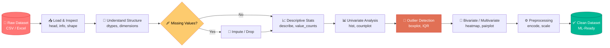

<div align="center">


<a href="https://git.io/typing-svg">
  
</a>

<br/>


</div>

---

## 🧭 Quick Navigations

| 🚀 | 📐 | 🔬 | 📊 | 🛠️ |
|:--:|:--:|:--:|:--:|:--:|
| [Overview](#-overview) | [Architecture](#-project-architecture) | [Pipeline](#-pipeline-explained-click-to-expand) | [Visuals](#-visualization-gallery) | [Run It](#-getting-started) |

---

## 🎯 Overview

> **Raw data is messy. Good models need clean data.**
> This project walks through a complete **Exploratory Data Analysis (EDA)**, **Data Cleaning**, and **Preprocessing** workflow, turning a raw dataset into a reliable, analysis-ready one.

```text
        ┌──────────────────────────────────────────┐
       ╱│   RAW DATA  ➜  CLEAN DATA  ➜  INSIGHTS   │╲
      ╱ └──────────────────────────────────────────┘ ╲
     ╱   ░░░░░░░░░░░░░░░░░░░░░░░░░░░░░░░░░░░░░░░░░░   ╲
    ╱____▒▒▒▒▒▒▒▒▒▒▒▒▒▒▒▒▒▒▒▒▒▒▒▒▒▒▒▒▒▒▒▒▒▒▒▒▒▒▒▒▒_____╲
    ╲▓▓▓▓▓▓▓▓▓▓▓▓▓▓▓▓▓▓▓▓▓▓▓▓▓▓▓▓▓▓▓▓▓▓▓▓▓▓▓▓▓▓▓▓▓▓▓▓▓▓▓╱
     ╲___________   DATA  QUALITY  LAYER   ___________╱
```

### ✅ What this project covers

- 📥 Loading and inspecting the dataset
- 🧱 Understanding structure, dimensions, and data types
- 🩹 Handling missing values and checking data quality
- 📈 Descriptive statistics for key features
- 📊 Distributions with histograms and count plots
- 🚨 Outlier detection using boxplots
- 🔗 Exploring relationships and patterns
- 🤖 Preparing the dataset for machine learning

---

## 🏗️ Project Architecture

Click-free, rendered natively by GitHub (Mermaid):



### 🧊 Layered View (3D-style stack)

```text
        ╱▔▔▔▔▔▔▔▔▔▔▔▔▔▔▔▔▔▔▔▔▔▔▔▔▔▔╲
       ╱  LAYER 5 · ML-READY DATA   ╲        ← Output
      ╱▔▔▔▔▔▔▔▔▔▔▔▔▔▔▔▔▔▔▔▔▔▔▔▔▔▔▔▔▔▔╲
     ╱  LAYER 4 · PREPROCESSING       ╲      ← Encode, scale
    ╱▔▔▔▔▔▔▔▔▔▔▔▔▔▔▔▔▔▔▔▔▔▔▔▔▔▔▔▔▔▔▔▔▔▔╲
   ╱  LAYER 3 · VISUAL EXPLORATION      ╲    ← Plots, outliers
  ╱▔▔▔▔▔▔▔▔▔▔▔▔▔▔▔▔▔▔▔▔▔▔▔▔▔▔▔▔▔▔▔▔▔▔▔▔▔▔╲
 ╱  LAYER 2 · CLEANING & QUALITY CHECKS   ╲  ← Missing, duplicates
╱▔▔▔▔▔▔▔▔▔▔▔▔▔▔▔▔▔▔▔▔▔▔▔▔▔▔▔▔▔▔▔▔▔▔▔▔▔▔▔▔▔▔╲
▏  LAYER 1 · RAW DATA INGESTION            ▕  ← Load & inspect
▔▔▔▔▔▔▔▔▔▔▔▔▔▔▔▔▔▔▔▔▔▔▔▔▔▔▔▔▔▔▔▔▔▔▔▔▔▔▔▔▔▔▔▔
```

---

## 🔬 Pipeline Explained (click to expand)

<details>
<summary><b>📥 Step 1 · Load & Inspect the Data</b></summary>

<br/>

**Goal:** Get a first feel for the dataset.

```python
import pandas as pd
import numpy as np
import matplotlib.pyplot as plt
import seaborn as sns

df = pd.read_csv("data/dataset.csv")

df.head()          # first look
df.tail()          # last rows
df.sample(5)       # random peek
```

💡 **Why it matters:** You can't fix what you haven't seen.

</details>

<details>
<summary><b>🧱 Step 2 · Understand Structure, Dimensions & Data Types</b></summary>

<br/>

```python
print("Shape:", df.shape)
df.info()
print(df.dtypes)
print(df.columns.tolist())
```

| Check | Tells you |
|---|---|
| `df.shape` | Rows × columns |
| `df.info()` | Non-null counts, dtypes, memory |
| `df.dtypes` | Numeric vs categorical vs date |

⚠️ **Watch out:** numbers stored as `object`, dates stored as strings.

</details>

<details>
<summary><b>🩹 Step 3 · Missing Values & Data Quality</b></summary>

<br/>

```python
# Count and percentage of missing values
missing = df.isnull().sum()
missing_pct = (missing / len(df) * 100).round(2)
print(pd.DataFrame({"Missing": missing, "Percent": missing_pct}))

# Visualize missingness
sns.heatmap(df.isnull(), cbar=False, cmap="viridis")
plt.title("Missing Value Map")
plt.show()

# Duplicates
print("Duplicates:", df.duplicated().sum())
df = df.drop_duplicates()
```

**Common strategies**

| Situation | Strategy |
|---|---|
| Numeric, roughly symmetric | Fill with **mean** |
| Numeric, skewed | Fill with **median** |
| Categorical | Fill with **mode** |
| Too many missing (>40–50%) | Consider **dropping** the column |

```python
df["numeric_col"] = df["numeric_col"].fillna(df["numeric_col"].median())
df["category_col"] = df["category_col"].fillna(df["category_col"].mode()[0])
```

</details>

<details>
<summary><b>📈 Step 4 · Descriptive Statistics</b></summary>

<br/>

```python
df.describe()                    # numeric summary
df.describe(include="object")    # categorical summary
df["category_col"].value_counts()
df.skew(numeric_only=True)       # distribution shape
```

🧠 Look at the gap between **mean** and **median**. A big gap hints at skew or outliers.

</details>

<details>
<summary><b>📊 Step 5 · Distributions (Histograms & Count Plots)</b></summary>

<br/>

```python
# Numeric features
df.hist(figsize=(14, 10), bins=30, edgecolor="black")
plt.tight_layout()
plt.show()

# Categorical features
plt.figure(figsize=(8, 5))
sns.countplot(data=df, x="category_col", palette="viridis")
plt.xticks(rotation=45)
plt.show()
```

| Plot | Best for |
|---|---|
| Histogram | Shape of numeric data |
| KDE plot | Smooth distribution |
| Count plot | Category frequency / imbalance |

</details>

<details>
<summary><b>🚨 Step 6 · Outlier Detection (Boxplots + IQR)</b></summary>

<br/>

```python
sns.boxplot(x=df["numeric_col"], color="skyblue")
plt.show()

# IQR method
Q1 = df["numeric_col"].quantile(0.25)
Q3 = df["numeric_col"].quantile(0.75)
IQR = Q3 - Q1
lower, upper = Q1 - 1.5 * IQR, Q3 + 1.5 * IQR

outliers = df[(df["numeric_col"] < lower) | (df["numeric_col"] > upper)]
print(f"Outliers found: {len(outliers)}")
```

```text
   ├────────┤█████████│█████████├────────┤      ●  ●
 lower      Q1      median     Q3       upper   outliers
 whisker                                whisker
```

**Options:** keep (if real), cap/winsorize, transform (log), or remove (if errors).

</details>

<details>
<summary><b>🔗 Step 7 · Relationships & Patterns</b></summary>

<br/>

```python
# Correlation heatmap
plt.figure(figsize=(10, 8))
sns.heatmap(df.corr(numeric_only=True), annot=True, cmap="coolwarm", fmt=".2f")
plt.title("Correlation Matrix")
plt.show()

# Pairwise relationships
sns.pairplot(df, hue="target_col")
plt.show()

# Numeric vs category
sns.boxplot(data=df, x="category_col", y="numeric_col")
plt.show()
```

</details>

<details>
<summary><b>⚙️ Step 8 · Prepare for Machine Learning</b></summary>

<br/>

```python
from sklearn.preprocessing import LabelEncoder, StandardScaler

# Encode categoricals
df = pd.get_dummies(df, columns=["category_col"], drop_first=True)

# Scale numerics
scaler = StandardScaler()
num_cols = df.select_dtypes(include="number").columns
df[num_cols] = scaler.fit_transform(df[num_cols])

# Save the clean dataset
df.to_csv("data/cleaned_dataset.csv", index=False)
```

✅ Output: a clean, encoded, scaled dataset ready for modeling.

</details>

---

## 🖼️ Visualization Gallery

> Replace the placeholders below with screenshots from your notebook (save them in an `assets/` folder).

<div align="center">

| 📊 Histogram | 📦 Boxplot | 🔥 Heatmap |
|:--:|:--:|:--:|
|  |  |  |

🎥 **Demo:** add your screen recording link here ➜ `[Watch Walkthrough](https://your-video-link)`

</div>

---

## 🔄 Before vs After

| Metric | 🔴 Raw Data | 🟢 Cleaned Data |
|---|:--:|:--:|
| Missing values | _x_ | **0** |
| Duplicate rows | _x_ | **0** |
| Outliers flagged | _x_ | **handled** |
| Data types | inconsistent | **fixed** |
| ML-ready | ❌ | ✅ |

---

## 📂 Repository Structure

```text
📦 eda-data-cleaning-preprocessing
 ┣ 📂 data
 ┃ ┣ 📜 dataset.csv
 ┃ ┗ 📜 cleaned_dataset.csv
 ┣ 📂 notebooks
 ┃ ┗ 📓 EDA_and_Preprocessing.ipynb
 ┣ 📂 assets
 ┃ ┣ 🖼️ histogram.png
 ┃ ┣ 🖼️ boxplot.png
 ┃ ┗ 🖼️ heatmap.png
 ┣ 📜 requirements.txt
 ┗ 📜 README.md
```

---

## 🛠️ Getting Started

```bash
# 1️⃣ Clone the repository
git clone https://github.com/<your-username>/<your-repo>.git
cd <your-repo>

# 2️⃣ (Optional) Create a virtual environment
python -m venv venv
source venv/bin/activate        # Windows: venv\Scripts\activate

# 3️⃣ Install dependencies
pip install -r requirements.txt

# 4️⃣ Launch Jupyter
jupyter notebook
```

**`requirements.txt`**

```text
pandas
numpy
matplotlib
seaborn
scikit-learn
jupyter
```

---

## 💡 Key Takeaways

- 🧹 **Clean data > fancy models.** Most ML problems start as data problems.
- 👀 **Visualize early.** Plots reveal what summary statistics hide.
- 🧪 **Document every decision.** Why you imputed, capped, or dropped matters.
- 🔁 **EDA is iterative.** You'll revisit earlier steps as you learn more.

---

## 🚀 Future Improvements

- [ ] Automated profiling with `ydata-profiling`
- [ ] Interactive plots with Plotly
- [ ] Feature engineering & selection
- [ ] Baseline ML model on the cleaned data
- [ ] Streamlit dashboard for live exploration

---

## 🤝 Connect

<div align="center">

[](https://linkedin.com/in/your-profile)
[](https://github.com/your-username)

⭐ **If this project helped you, drop a star!** ⭐

`#DataAnalytics` `#DataScience` `#EDA` `#DataCleaning` `#Python` `#Pandas` `#Seaborn` `#Matplotlib` `#MachineLearning`


</div>
